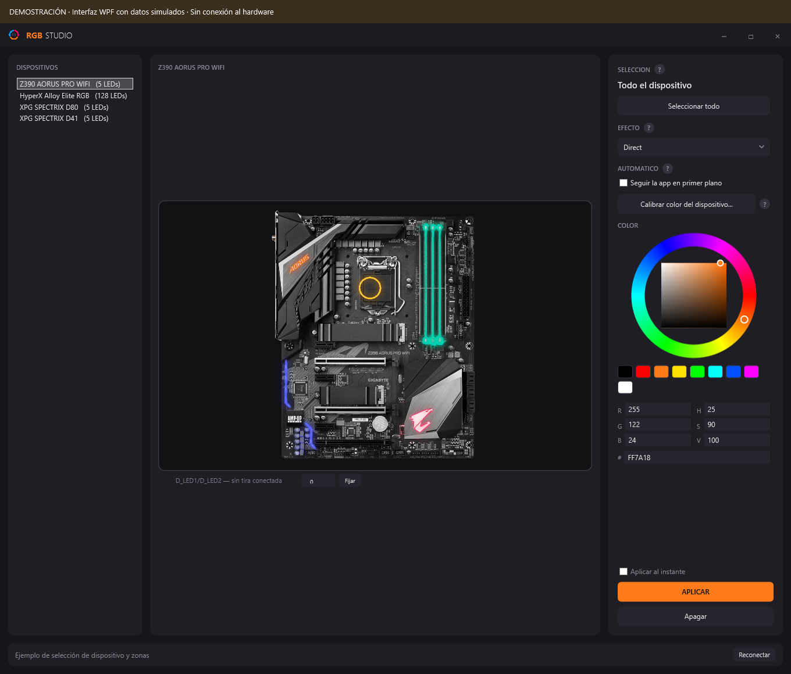
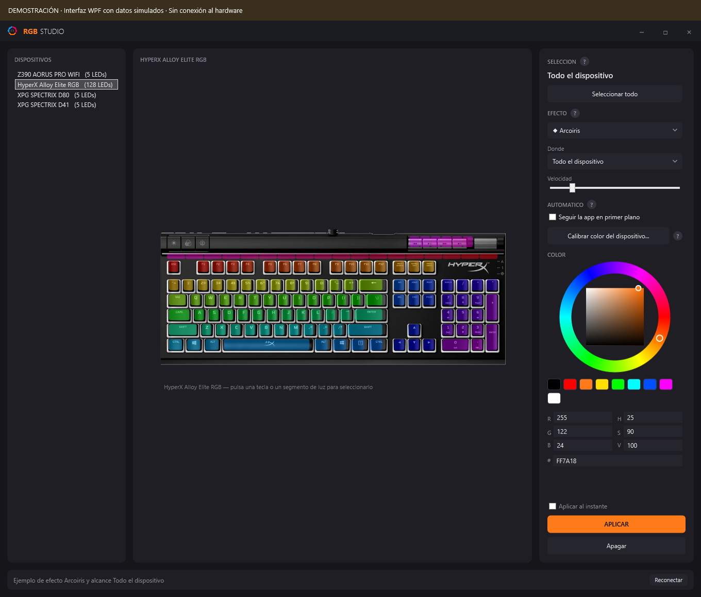
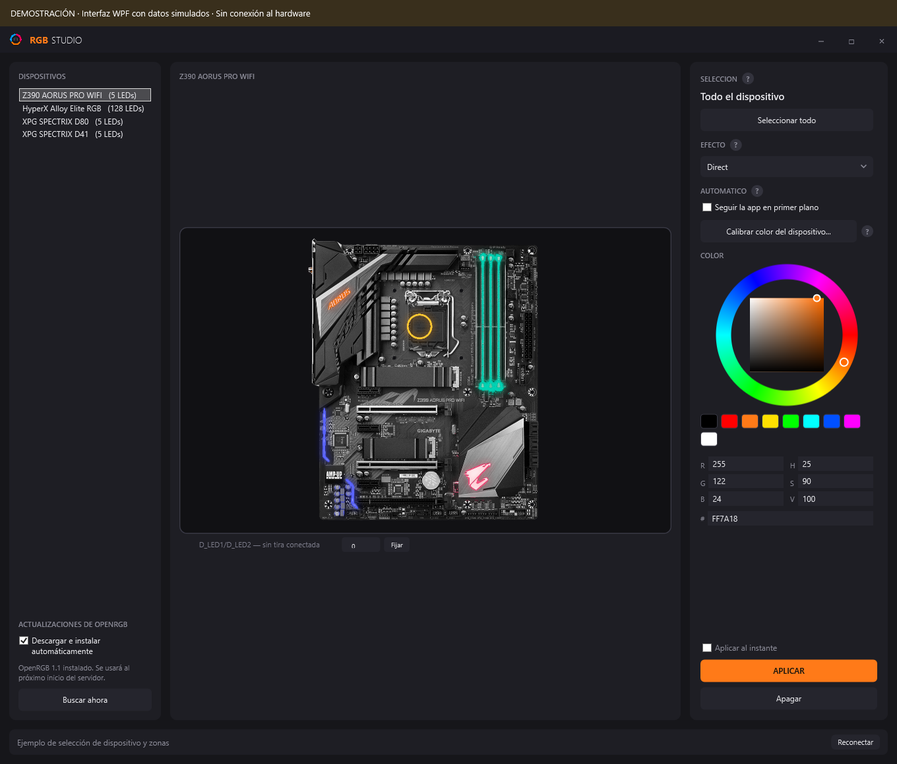

# RGB Studio

Aplicación de escritorio para Windows que controla la iluminación RGB de la placa base,
el teclado y la memoria desde una sola ventana. Permite elegir zonas o LED individuales,
combinar efectos y ajustar el color de cada dispositivo mediante OpenRGB.



*Interfaz WPF del proyecto con datos de demostración. Los colores y dispositivos de esta
imagen son ilustrativos; no representan una validación física del hardware.*

## Documentación

- [Guía visual de uso](docs/GUIA-DE-USO.md): conexión, selección, colores, efectos, calibración y bandeja.
- [Arquitectura y desarrollo](docs/DESARROLLO.md): módulos, comunicación, compilación y validación manual.
- [Origen y actualización de las imágenes](docs/IMAGENES.md).
- [Instalador, releases y actualizaciones de RGB Studio](docs/RELEASES.md).

## Instalar sin compilar

Descarga el instalador de [la última versión de RGB Studio](https://github.com/corpjorge/RGB-Studio/releases/latest),
ejecútalo y abre **RGB Studio** desde el menú Inicio. Es una instalación para el usuario actual,
con desinstalador y .NET incluido: no necesitas Visual Studio ni el SDK de .NET.

Requiere Windows x64 (Windows 11 recomendado; mínimo del instalador: Windows 10 22H2) e Internet
para la primera descarga de OpenRGB. La aplicación lo prepara e inicia automáticamente cuando
el servidor no está disponible. OpenRGB puede pedir permiso de administrador. Para la RAM y otros
dispositivos SMBus, instala [PawnIO](https://pawnio.eu) desde su fuente oficial.

RGB Studio busca sus propias versiones al iniciar y cada seis horas. Cuando aparece un release
nuevo, descarga su instalador y muestra **Actualizar y reiniciar**; también lo instala al salir
desde la bandeja si el modo automático está activo. Los perfiles de color y las tiras se conservan.

El instalador actual no tiene una firma de editor: Windows puede mostrar un aviso de editor
desconocido. La compatibilidad de los dispositivos depende de OpenRGB.

## Funciones principales

- Mapas sobre fotografías de la Z390 AORUS PRO WIFI, HyperX Alloy Elite RGB y memorias XPG SPECTRIX.
- Color por zona, tecla o segmento de luz; selección del dispositivo completo.
- Modos de firmware y **23 efectos animados por software**, además de **Color sólido**.
- Alcance de los efectos propios: parte seleccionada, dispositivo o todos los dispositivos.
- Rueda HSV, paleta rápida y entrada de valores RGB o hexadecimal.
- Efectos **Audio reactivo** y **Teclas reactivas**.
- Color automático a partir del icono de la aplicación en primer plano.
- Calibración RGB por dispositivo y por zona de la placa catalogada, con perfiles guardados.
- Configuración de la longitud de tiras direccionables y funcionamiento en segundo plano.
- Detección, descarga e instalación automática de nuevas versiones estables de OpenRGB para Windows x64.
- Instalador con .NET incluido y actualización de RGB Studio desde los releases de GitHub.

## Requisitos

- Windows x64 y **.NET 10 SDK** para compilar y ejecutar los comandos de desarrollo.
- [OpenRGB](https://openrgb.org) con su servidor SDK en **127.0.0.1:6742**.
- Para detectar la RAM mediante SMBus en este equipo: [PawnIO](https://pawnio.eu) y OpenRGB
  ejecutado como administrador. RGB Studio no requiere elevación.

Los binarios de OpenRGB y los módulos de terceros no se incluyen en este repositorio. La aplicación
puede descargar automáticamente la distribución portátil oficial de OpenRGB; PawnIO se instala
por separado. La detección y las funciones disponibles dependen del controlador de OpenRGB.

## Inicio rápido

Desde la raíz del repositorio:

```powershell
dotnet restore App/App.csproj
dotnet build App/App.csproj -c Release
```

Abre **RGB Studio.cmd**. El lanzador prioriza la versión oficial preparada en
`%LocalAppData%\RgbStudio\OpenRGB\versions\`, comprobando su manifiesto y el hash del ejecutable.
Si no hay ninguna utilizable, busca OpenRGB en estas carpetas hermanas:

```text
RGBFusionSDK/
├── RgbStudio/                  Este repositorio
├── OpenRGB-Custom-Build-v2/
│   └── OpenRGB.exe             Respaldo personalizado
└── OpenRGB/
    └── OpenRGB.exe             Respaldo
```

Si el servidor ya escucha en el puerto 6742, el lanzador lo reutiliza. En caso contrario,
solicita elevación para iniciar OpenRGB con `--server`, espera hasta 25 segundos y abre
`App/bin/Release/net10.0-windows/RgbStudio.exe`. También abre la interfaz si OpenRGB no aparece;
la barra inferior mostrará el estado sin conexión.

Si OpenRGB está instalado en otra ubicación, inicia su servidor SDK manualmente y ejecuta:

```powershell
dotnet run --project App/App.csproj
```

1. Elige un dispositivo en la columna izquierda.
2. Selecciona **Direct** para pintar una parte, o un efecto marcado con **◆**.
3. Pulsa una zona, tecla o segmento en el mapa y elige un color.
4. Con **Aplicar al instante** activo, los cambios se envían automáticamente. Desmárcalo
   para preparar la selección y usar **APLICAR**.

Para los efectos **◆**, revisa **Donde**: su valor inicial es **Todos los dispositivos**.
**Apagar** actúa sobre todo el dispositivo seleccionado.



*Demostración de la interfaz; consulta los pasos y alcances en la [guía visual](docs/GUIA-DE-USO.md).*

## Actualizaciones automáticas de OpenRGB

El panel **ACTUALIZACIONES DE OPENRGB**, debajo de la lista de dispositivos, está activado por
defecto. Busca versiones estables oficiales al iniciar y cada seis horas, descarga el ZIP de
Windows x64 y prepara la instalación en segundo plano. **Buscar ahora** permite comprobarla de
inmediato; desmarcar la casilla desactiva la búsqueda automática y cancela una descarga en curso.



*Demostración de la interfaz con una actualización preparada; no representa una prueba de hardware.*

La actualización se usa **cuando vuelva a iniciarse el servidor de OpenRGB desde el lanzador**.
No se reinicia un servidor activo durante un efecto. Cierra OpenRGB desde su propia bandeja y
abre `RGB Studio.cmd`, o utiliza el lanzador después de reiniciar Windows. Cerrar la ventana de
RGB Studio solo la oculta: no detiene OpenRGB.

En la primera comprobación se prepara la estable oficial si todavía no hay una instalación
administrada, aunque tengas una compilación personalizada. Esta se conserva. Para volver a ella,
cierra primero OpenRGB y ejecuta:

```powershell
.\Iniciar.ps1 -UsarOpenRgbAnterior
```

También puedes pasar `-UsarOpenRgbAnterior` a `RGB Studio.cmd`. Esta opción omite las versiones
administradas durante ese arranque. Consulta [el funcionamiento y los respaldos](docs/GUIA-DE-USO.md#10-actualizaciones-de-openrgb).

## Catálogo de efectos propios

Los nombres siguientes corresponden al selector de la aplicación. Las entradas propias llevan **◆**.

| Grupo | Opciones |
| --- | --- |
| Color fijo | Color sólido |
| Movimiento y pulso | Onda, Respiracion suave, Degradado en movimiento, Cometa, Latido, Escáner, Respiración doble, Onda expansiva continua |
| Color y ambientación | Arcoiris, Fuego, Ciclo de color, Aurora, Estrellas, Bandas luminosas, Plasma |
| Temáticos | Bandera de Colombia, Princesa, Policía |
| Reactivos | Teclas reactivas, Audio reactivo |
| Espaciales | Lluvia, Ondas concentricas, Barrido diagonal |

**Teclas reactivas** necesita una matriz de teclado. Lluvia, Ondas concentricas y Barrido diagonal
se marcan como «mejor en teclado» en dispositivos sin matriz. Audio reactivo utiliza el sonido
reproducido por Windows; en el teclado muestra una barra y, en dispositivos sin matriz, pulsos
al ritmo de los golpes detectados. Los efectos reactivos no muestran el control de velocidad.

## Hardware y alcance

El catálogo de zonas de la placa se desarrolló para la **Z390 AORUS PRO WIFI**. En placas
sin catálogo se usa una rejilla genérica. El README anterior registraba comprobaciones sobre
esa placa (5 LED en 6 zonas, con la cabecera vacía), un HyperX Alloy Elite RGB (128 LED) y
dos módulos ENE / XPG SPECTRIX (5 LED cada uno); esto no garantiza compatibilidad con otros modelos.

La interfaz distingue los dos dispositivos llamados `ENE DRAM` como D80 y D41 según su orden
de enumeración. Es una convención de este equipo, no una detección automática del modelo.

## Desarrollo

```powershell
dotnet build App/App.csproj -c Release
dotnet build test-connection/test-connection.csproj -c Release
dotnet run --project test-connection -- list
```

`list` enumera dispositivos, zonas y modos. `map` y `walk` cambian la iluminación de la placa
Z390 y se reservan para validación manual con hardware conectado. Consulta la
[guía de desarrollo](docs/DESARROLLO.md) antes de mapear otro equipo.
