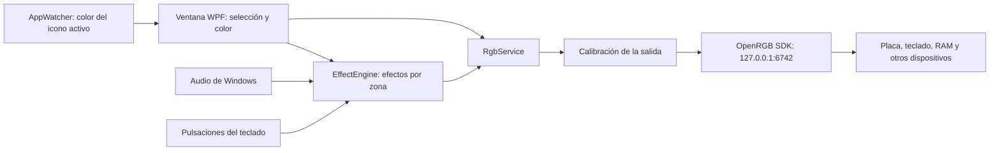

# Arquitectura y desarrollo

[Volver al README](../README.md) · [Guía visual](GUIA-DE-USO.md)

## Flujo de funcionamiento



RGB Studio no usa el SDK propietario de GIGABYTE. El servicio de OpenRGB realiza la comunicación
con el hardware. La ventana mantiene la selección y el color; el motor calcula los efectos
animados aproximadamente cada 66 ms. La calibración se aplica a la salida, sin alterar el
estado lógico mostrado en el mapa.

## Organización del repositorio

| Ruta | Responsabilidad |
| --- | --- |
| `App/MainWindow.xaml` y `.xaml.cs` | Ventana, selección, alcance de efectos, comandos y coordinación. |
| `App/Controls/ColorPicker*` | Rueda HSV, paleta y edición RGB/hexadecimal. |
| `App/CalibrationWindow*` | Diálogo y validación de ganancias y gamma. |
| `App/Rgb/RgbService.cs` | Cliente OpenRGB, estado de los LED, modos y tamaño de zonas. |
| `App/Rgb/ZoneCatalog.cs` | Nombres y posiciones de zonas conocidas de la Z390. |
| `App/Rgb/ColorCalibration.cs` | Curvas por canal y persistencia de perfiles. |
| `App/Rgb/StripSizes.cs` | Longitudes de las tiras y restauración al conectar. |
| `App/Effects/SoftwareEffect.cs` | Catálogo y muestreo de los 23 efectos animados. |
| `App/Effects/EffectEngine.cs` | Asignaciones por dispositivo/zona y envío de cuadros. |
| `App/Effects/AudioLevelMonitor.cs` | Captura del audio de salida mediante NAudio. |
| `App/Effects/KeyboardPulseTracker.cs` | Pulsaciones para el efecto reactivo del teclado. |
| `App/Rendering/DeviceRenderer.cs` | Fotografías, máscaras, teclas y zonas pulsables. |
| `App/Assets/` | Icono y fotografías utilizadas por la interfaz. |
| `App/AppWatcher.cs` | Color representativo del icono de la app en primer plano. |
| `App/TrayIcon.cs` | Bandeja, restauración y salida. |
| `App/App.xaml.cs` | Instancia única y ciclo de vida. |
| `test-connection/` | Utilidad de consola para inspección y pruebas manuales. |
| `Iniciar.ps1` y `RGB Studio.cmd` | Arranque de OpenRGB y la aplicación compilada. |
| `docs/` | Guía de uso, arquitectura e imágenes. |

## Compilar y ejecutar

Requiere Windows y .NET 10 SDK. Desde la raíz:

```powershell
dotnet restore App/App.csproj
dotnet build App/App.csproj -c Release
dotnet build test-connection/test-connection.csproj -c Release
dotnet run --project App/App.csproj
```

La aplicación WPF compila para `net10.0-windows`, con destino x64, y usa OpenRGB.NET 3.1.1 y
NAudio 2.2.1. La utilidad usa `net10.0` y OpenRGB.NET 3.1.1. Los paquetes se declaran en cada `.csproj`.
Las salidas de compilación quedan en `bin/` y `obj/`, excluidos de Git.

## Restricciones de la comunicación RGB

- **Direct antes de pintar.** El firmware puede ignorar las actualizaciones de LED en otro modo.
- **Un envío completo por dispositivo.** Las actualizaciones sucesivas por zona resultaron
  poco fiables con el IT8297; se conserva el estado de todos los LED y se envía un cuadro completo.
- **El modo determina cómo recibe color.** `ModeSpecific` lleva los colores en el paquete de modo;
  `PerLed` necesita una actualización de LED; `None` usa su propia paleta.
- **Acceso serializado.** `RgbService` protege cliente y estado con un cerrojo. El motor y las
  operaciones de aplicación de color trabajan fuera del hilo de la ventana.
- **Calibración al enviar.** Se corrige una copia para evitar acumular la curva cuadro a cuadro.
  Los perfiles de zona sustituyen al general en las zonas correspondientes.
- **Asignaciones por zona.** Un efecto animado se guarda por `(dispositivo, zona)`; `-1` representa
  el dispositivo entero. Color sólido también permite pintar un LED individual.
- **Color y velocidad compartidos al actualizar.** `UpdateColor` y `UpdateSpeed` cambian todas las
  asignaciones activas del motor.

## Datos locales

| Archivo | Contenido y clave |
| --- | --- |
| `%AppData%\RgbStudio\calibracion.json` | Ganancia y gamma por nombre de dispositivo; para zonas, `nombre::zona:índice`. |
| `%AppData%\RgbStudio\tiras.json` | Cantidad de LED por `nombre|índice de zona`. |

Los nombres duplicados de OpenRGB comparten claves. El alias visual D80/D41 no modifica el nombre
de hardware usado al guardar. Estas preferencias no son un sistema de escenas: no se guardan
en ellas las selecciones de color ni las asignaciones de efectos.

## Catálogo de la placa y compatibilidad

El catálogo actual identifica nombres que contienen `Z390` y mapea las zonas 1–5 a Logo AORUS,
Contorno RAM, Aguila AORUS, Linea inferior y Ventiladores y disipador. Este mapa corresponde al
equipo Z390 AORUS PRO WIFI usado durante el desarrollo; no debe suponerse válido para cualquier Z390.
Las cabeceras redimensionables sin entrada en el catálogo se dibujan aparte.

La compilación personalizada de OpenRGB usada por el lanzador está fuera del repositorio. La
documentación previa registra que normaliza el sufijo DMI `-CF` para encontrar el diseño correcto
de la placa. Un OpenRGB distinto puede exponer zonas diferentes.

Para incorporar una placa nueva, inspecciona primero lo que expone OpenRGB. Conserva el dibujo
genérico para equipos sin catálogo y verifica las correspondencias físicas antes de añadir nombres.

## Inspección y pruebas manuales

No hay un proyecto de pruebas automatizadas. Cada cambio debe compilar ambos proyectos.

```powershell
dotnet run --project test-connection -- list
```

`list` lee el inventario, zonas y modos. Los siguientes comandos **cambian la iluminación** y
requieren hardware conectado; la implementación actual busca una placa cuyo nombre contenga `Z390`:

```powershell
dotnet run --project test-connection -- map
dotnet run --project test-connection -- walk
```

`map` asigna colores distintos a las zonas con LED y espera Enter para apagarlas. `walk` las
enciende una a una y espera una observación antes de avanzar; al terminar apaga la placa.
Se recomienda evitar que otra interfaz o utilidad vuelva a imponer colores mientras se prueba.

Para una validación de RGB, registra:

| Dato | Qué anotar |
| --- | --- |
| Entorno | Fecha, Windows y versión o compilación exacta de OpenRGB. |
| Inventario | Nombre publicado, número de LED, zonas y modo del dispositivo. |
| Acción | Comando exacto o selección/efecto/alcance usado en la interfaz. |
| Resultado | Qué se observó físicamente y si coincide con lo esperado. |
| Evidencia | Captura de la interfaz y, si corresponde, fotografía del hardware. |

Para cambios de interfaz, revisa además la selección, el desplazamiento del panel derecho y
que APLICAR y Apagar sigan accesibles. Las capturas con datos simulados sirven para documentar
los controles, pero no demuestran detección ni respuesta física de los dispositivos.

## Validación de esta documentación

El 22 de octubre de 2026 se compilaron ambos proyectos en Release sin errores. NuGet emitió
advertencias `NU1900` al no poder consultar la información de vulnerabilidades en `api.nuget.org`.
La aplicación se abrió y se capturó el estado sin conexión. El comando
`dotnet run --project test-connection/test-connection.csproj -c Release --no-build -- list`
informó que no pudo conectarse a OpenRGB en `127.0.0.1:6742`. No se validaron efectos en hardware
ni una versión de servidor; las vistas de dispositivos usan datos de demostración.
