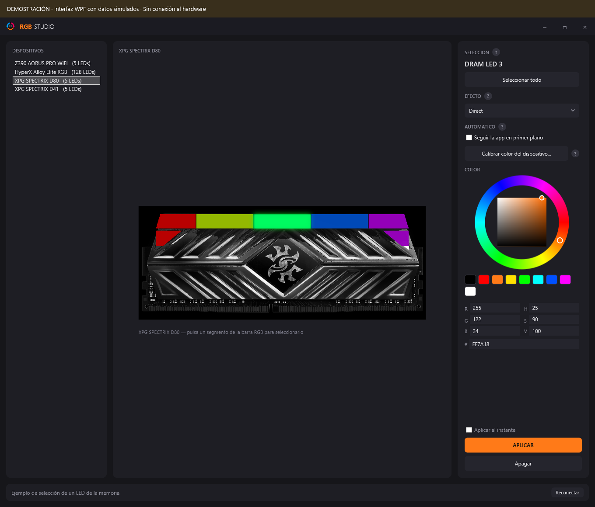
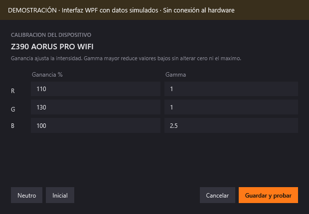
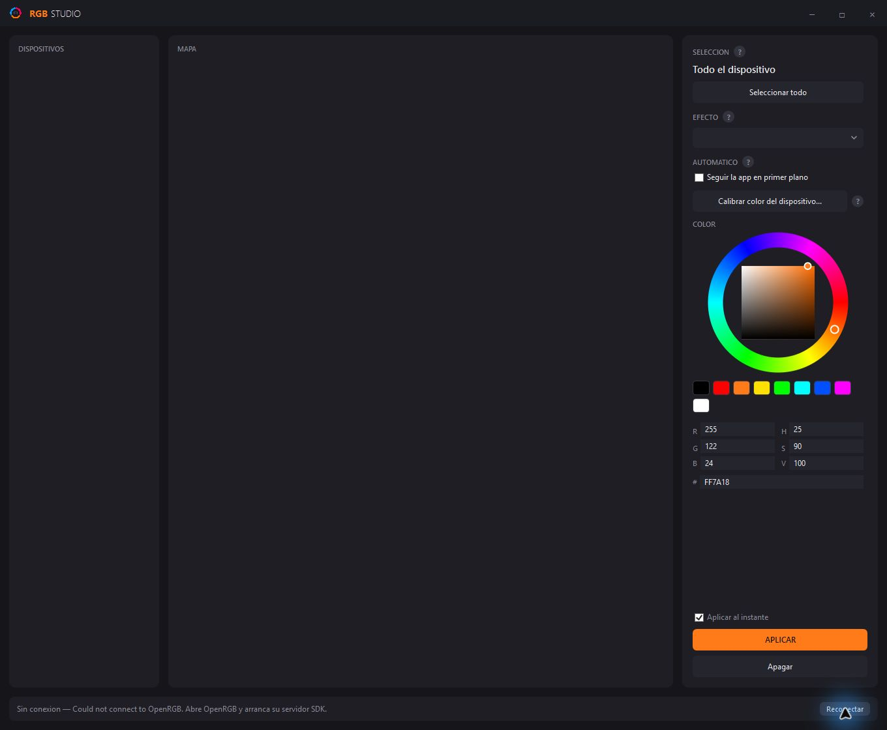

# Guía visual de RGB Studio

[Volver al README](../README.md)

Esta guía explica los controles de la aplicación actual. Las imágenes con la banda
«DEMOSTRACIÓN» usan la interfaz WPF del repositorio y datos simulados. La última imagen
es una captura real del estado sin conexión. [Detalle de las imágenes](IMAGENES.md).

## 1. Conectar los dispositivos

Compila el proyecto y abre `RGB Studio.cmd` como se indica en el [inicio rápido](../README.md#inicio-rápido).
OpenRGB debe tener activo su servidor SDK en `127.0.0.1:6742`.

Cuando hay conexión, la barra inferior indica el número de dispositivos y la columna izquierda
lista los que OpenRGB detectó. Selecciona uno para cargar su mapa. Pulsa **Reconectar** después
de iniciar el servidor o cambiar el inventario.


| Área | Cómo se usa |
| --- | --- |
| Dispositivos, izquierda | Cambia entre placa, teclado y módulos de RAM. |
| Mapa, centro | Pulsa una zona, tecla o segmento de luz. La selección se resalta. |
| Seleccion, derecha | Comprueba qué parte recibirá el color; **Seleccionar todo** vuelve al dispositivo completo. |
| Efecto | Elige un modo del dispositivo o una entrada propia marcada con **◆**. |
| Color | Ajusta el tono, saturación y brillo, usa la paleta o escribe RGB/hexadecimal. |
| Controles inferiores | Activa la aplicación inmediata, envía con **APLICAR** o apaga el dispositivo. |
| Barra de estado | Revisa la conexión, el resultado de la última operación y los errores. |

## 2. Pintar una zona o una tecla

Para preparar los cambios antes de enviarlos:

1. Desmarca **Aplicar al instante**.
2. Elige el dispositivo y el modo **Direct**.
3. Pulsa la parte que quieres pintar en el mapa.
4. Comprueba su nombre bajo **SELECCION**.
5. Elige un color y pulsa **APLICAR**.

Repite los pasos para otra zona. El modo Direct conserva el color lógico de los demás LED.
En el teclado puedes elegir una tecla o un segmento de su barra RGB; en la RAM, un segmento
de la barra luminosa.



Con **Aplicar al instante** marcado, pulsar una parte también le aplica el color o efecto
actual. Cambiar el color o el efecto puede enviarlo inmediatamente.

**Apagar** detiene los efectos y envía negro a **todo el dispositivo seleccionado**, aunque
hayas seleccionado un solo LED. Para apagar únicamente una parte, usa Direct, selecciona esa
parte, elige `000000` y pulsa APLICAR.

Si pintas manualmente una tecla de un dispositivo que tenía un efecto en todo el dispositivo,
se retira ese efecto para que no sobrescriba el nuevo color. Los efectos en otros dispositivos
pueden seguir funcionando.

## 3. Elegir un color

- Arrastra el selector del anillo para cambiar el tono.
- Usa el cuadrado interior para ajustar saturación y brillo.
- Pulsa una muestra de la paleta para un color rápido.
- Escribe valores entre **0 y 255** en R, G y B, o seis dígitos hexadecimales, por ejemplo `FF7A18`.

Los campos H, S y V muestran el equivalente HSV. La vista del dispositivo representa los colores
lógicos; la calibración modifica lo enviado al hardware y puede producir diferencias con el mapa.

## 4. Aplicar efectos

Los modos sin **◆** pertenecen al firmware del dispositivo; sus capacidades dependen de OpenRGB
y del controlador. Algunos usan sus propios colores e ignoran el elegido en la rueda.

Las entradas con **◆** se calculan en RGB Studio. **Color sólido** envía un color fijo una vez;
las demás producen animación mientras la aplicación sigue ejecutándose.


1. Desmarca **Aplicar al instante** si quieres preparar el efecto.
2. Selecciona un dispositivo y una entrada **◆** en **EFECTO**.
3. Revisa **Donde** y elige el alcance.
4. Ajusta el color y, cuando aparezca, la velocidad.
5. Pulsa **APLICAR**.

| Donde | Alcance |
| --- | --- |
| Solo la parte seleccionada | La zona seleccionada; para Color sólido también se respeta el LED individual. Los efectos animados se asignan por zona. |
| Todo el dispositivo | Todas las zonas del dispositivo elegido. |
| Todos los dispositivos | Todos los dispositivos detectados. Es el valor inicial. |

Para combinar una onda en la placa y un arcoíris en el teclado, aplica cada efecto con alcance
**Todo el dispositivo**, cambiando de dispositivo entre ambos. Para trabajar con zonas de la
placa, usa **Solo la parte seleccionada**. El motor admite varias asignaciones simultáneas.

El color y la velocidad se actualizan en los efectos activos del motor. Si hay varios efectos
simultáneos, estos ajustes se comparten. Cambiar **Donde** mientras hay efectos activos puede
iniciar la asignación al nuevo alcance, incluso con Aplicar al instante desmarcado.

### Efectos reactivos

**Teclas reactivas** ilumina la tecla pulsada y crea un halo en sus vecinas. Necesita la matriz
del teclado; en dispositivos sin matriz apenas muestra el color base.

**Audio reactivo** utiliza el audio reproducido por Windows. En el teclado con matriz muestra
el nivel como una barra; la placa y la RAM reaccionan con pulsos y se apagan entre golpes o
cuando hay silencio. Si no se puede iniciar la captura de audio, se informa en la barra inferior.

Estos dos efectos siguen eventos, por lo que no muestran un control de velocidad.

## 5. Seguir la aplicación en primer plano

Activa **Seguir la app en primer plano** y cambia a otra aplicación. RGB Studio obtiene un color
de su icono y muestra el nombre y una muestra del color en el panel.

Sin efectos por software activos, este modo pinta todos los dispositivos que admiten Direct.
Si hay efectos activos, actualiza su color base. Los efectos con paleta propia, como Arcoiris,
pueden no reflejar ese cambio. Desmarca la casilla para volver al color manual.

La propia ventana de RGB Studio se omite. Si no se obtiene un color útil del icono de una app,
se conserva el anterior.

## 6. Calibrar el color

La calibración compensa diferencias de respuesta entre dispositivos. Selecciona uno y pulsa
**Calibrar color del dispositivo...**. Si seleccionas una zona de la placa incluida en el
catálogo, el botón cambia a **Calibrar color de esta zona...**.



| Control | Función |
| --- | --- |
| Ganancia % | Ajusta la intensidad del canal. Intervalo: 0–300 %. |
| Gamma | Ajusta la curva del canal. Intervalo: 0,1–4. Un valor mayor oscurece los tonos intermedios. |
| Neutro | Rellena 100 % de ganancia y gamma 1 en los tres canales. |
| Inicial | Recupera los valores iniciales del dispositivo, incluidos los ajustes previstos para la Z390. |
| Cancelar | Cierra sin guardar los cambios del diálogo. |
| Guardar y probar | Guarda el perfil y actualiza la calibración. |

Con **Aplicar al instante** activo se vuelve a aplicar la selección al guardar. Si está desmarcado,
pulsa **APLICAR** para enviar el color corregido; los efectos activos usan la nueva calibración
en sus siguientes cuadros.

Los perfiles se guardan en `%AppData%\RgbStudio\calibracion.json`, asociados al nombre publicado
por OpenRGB. Una zona con perfil propio sustituye la corrección general en esa zona. Si dos
dispositivos tienen el mismo nombre, comparten la clave de calibración aunque la interfaz los
distinga como D80 y D41.

## 7. Configurar una tira direccionable

Cuando OpenRGB expone una cabecera redimensionable de la placa catalogada, aparece debajo del
mapa con un campo de longitud. Indica el número real de LED conectados y usa **Fijar**. Una longitud
de cero representa una cabecera vacía, cuando el controlador la admite.

La longitud se guarda en `%AppData%\RgbStudio\tiras.json` y se restaura al conectar. Al cambiarla
se detienen los efectos de ese dispositivo y se reconstruye su mapa.

## 8. Dejar la aplicación en segundo plano y salir

Tanto minimizar como pulsar **×** ocultan la ventana en la bandeja de Windows. RGB Studio sigue
activo y los efectos continúan.

- Haz doble clic en el icono de la bandeja o usa **Abrir RGB Studio** para recuperar la ventana.
- También puedes volver a ejecutar el lanzador: la instancia existente se trae al frente.
- Usa **Salir** en el menú del icono para finalizar la aplicación y detener su motor de efectos.

## 9. Resolver problemas de conexión y control



| Síntoma | Qué revisar |
| --- | --- |
| «Sin conexion» y lista vacía | Inicia OpenRGB y su servidor SDK en 127.0.0.1:6742; pulsa Reconectar. |
| La placa y el teclado aparecen, pero la RAM no | Revisa PawnIO y ejecuta OpenRGB como administrador; vuelve a detectar los dispositivos. |
| El color de una zona no cambia | Prueba Direct y APLICAR. Un modo de firmware puede imponer su propia paleta. |
| Los colores cambian al cambiar de ventana | Revisa Seguir la app en primer plano. |
| Un efecto alcanza más dispositivos de lo esperado | Revisa Donde; empieza en Todos los dispositivos. |
| La tira no aparece o tiene cero LED | Declara su longitud si la cabecera admite redimensionamiento. |
| El color físico difiere del mapa | Revisa la calibración del dispositivo y de la zona. |
| Static, Wave y Breathing se ven iguales en el HyperX | Es una limitación registrada del controlador; prueba los efectos propios ◆. |
| La ventana desaparece al cerrarla | Se ha ocultado en la bandeja; usa Abrir RGB Studio o Salir desde su icono. |

Para comprobar qué detecta el servidor, desde la raíz del repositorio:

```powershell
dotnet run --project test-connection -- list
```

Si necesitas registrar un problema de hardware, anota la versión de OpenRGB, el nombre del
dispositivo, el modo o comando usado y lo observado físicamente. Las imágenes de demostración
de esta guía no sustituyen esa validación.
