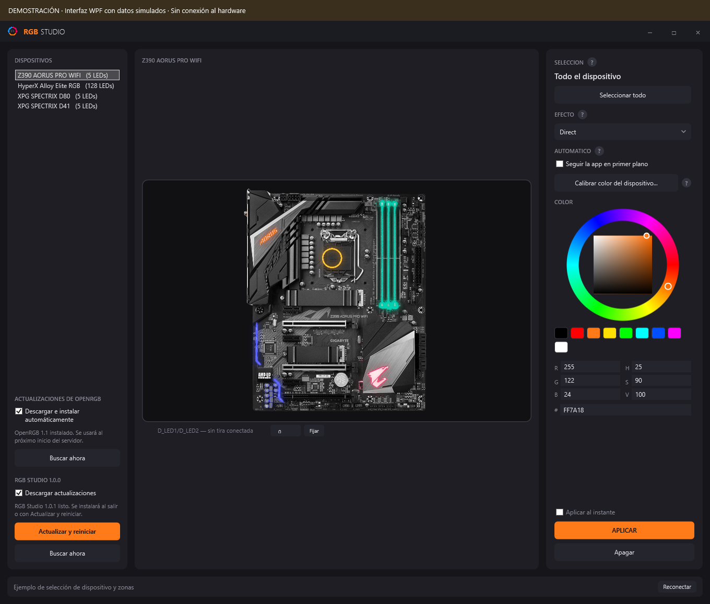

# Instalador y releases de RGB Studio

[Volver al README](../README.md) · [Guía visual](GUIA-DE-USO.md)

## Descargar e instalar

1. Abre [el último release](https://github.com/corpjorge/RGB-Studio/releases/latest).
2. Descarga `RGB-Studio-VERSION-win-x64-Setup.exe` y ejecútalo.
3. Abre **RGB Studio** desde Inicio o desde el acceso directo opcional del escritorio.
4. Espera la descarga inicial de OpenRGB y acepta su permiso de administrador si Windows lo solicita.

El paquete incluye el runtime de .NET y las dependencias WPF. No requiere el SDK, Visual Studio,
una copia del repositorio ni carpetas hermanas de desarrollo. Se instala para el usuario actual
en `%LocalAppData%\Programs\RgbStudio\` y aparece en las aplicaciones instaladas de Windows.

El mínimo configurado es Windows 10 22H2 x64; se recomienda Windows 11. La compatibilidad y soporte
del sistema operativo también dependen de [.NET](https://learn.microsoft.com/en-us/dotnet/core/install/windows).
OpenRGB necesita Internet para la primera descarga y puede solicitar elevación al arrancar. Para
la RAM mediante SMBus se requiere [PawnIO](https://pawnio.eu), instalado por separado desde su fuente
oficial. RGB Studio no instala silenciosamente controladores ni cambia la seguridad de Windows.

El instalador no está firmado con un certificado de editor. Windows puede mostrar un aviso de editor
desconocido. El archivo `.sha256` del release y el campo `digest` de GitHub permiten verificar la
integridad del instalador; no equivalen a una firma de código de Windows.

## Actualizar RGB Studio



*Demostración de la interfaz WPF con una versión posterior de ejemplo preparada para instalar.*

La aplicación consulta los releases estables de `corpjorge/RGB-Studio` al iniciar y cada seis horas.
No acepta borradores, prereleases ni versiones iguales o anteriores a la instalada. La comprobación
es pública y no utiliza tokens de GitHub ni credenciales del usuario.

Cuando hay una versión nueva:

1. Se descarga su instalador x64 en `%LocalAppData%\RgbStudio\Updates\VERSION\`.
2. Se comprueban el tamaño, el formato ejecutable y el SHA-256 publicado por GitHub.
3. Se muestra una notificación en la bandeja y el botón **Actualizar y reiniciar**.
4. Al pulsarlo, la app se cierra; un helper espera a que su proceso termine, vuelve a comprobar
   el hash, ejecuta el instalador silenciosamente en la misma carpeta y abre la nueva versión.

Si el modo automático sigue activo, salir desde **Salir** en la bandeja también instala una
actualización que ya esté preparada. Minimizar o pulsar **×** solo oculta la ventana y permite
que las descargas continúen. Desmarcar **Descargar actualizaciones** detiene la descarga activa
y evita la instalación automática al salir; el botón manual de actualización sigue disponible.

La actualización conserva `%AppData%\RgbStudio\` (calibración y tiras) y la instalación administrada
de OpenRGB bajo `%LocalAppData%\RgbStudio\OpenRGB\`. Tampoco reinicia un servidor OpenRGB activo.
Las copias ejecutadas desde el código fuente pueden comprobar y descargar versiones, pero no se
reemplazan automáticamente con un instalador: usa una copia instalada para ese flujo.

## Publicar una versión nueva

El workflow [Publicar instalador](../.github/workflows/release.yml) construye y publica el paquete
completo. Se puede ejecutar desde **Actions → Publicar instalador → Run workflow**, indicando
una versión mayor que la publicada, por ejemplo `1.0.1`.

Desde GitHub CLI, después de subir los cambios a `main`:

```powershell
gh workflow run release.yml --repo corpjorge/RGB-Studio --ref main -f version=1.0.1
```

También se activa al subir un tag `v1.0.1`. La versión del tag o del formulario se pasa a
`dotnet publish` y al instalador, de modo que el ejecutable publicado lleva exactamente esa versión.
No basta con cambiar el nombre del archivo ni adjuntar un ZIP a mano: el actualizador busca el asset
`RGB-Studio-VERSION-win-x64-Setup.exe` con el SHA-256 que GitHub calcula al subirlo.

El workflow:

- Compila la app y la utilidad de hardware, y ejecuta las comprobaciones sin hardware.
- Publica para `win-x64` con `--self-contained true`, sin trimming ni símbolos de depuración.
- Construye el instalador con una versión fijada de Inno Setup, validada por SHA-256.
- Instala el paquete en el runner de Windows y verifica el arranque sin utilizar .NET global.
- Prueba el helper de actualización y la desinstalación conservando los datos de usuario.
- Publica el release y sus archivos únicamente después de que pasen las pruebas.

Los binarios se adjuntan al release; no se agregan a Git. `main` sigue siendo la única rama;
los tags identifican las versiones publicadas.

## Construir localmente

```powershell
powershell -NoProfile -ExecutionPolicy Bypass -File scripts/Build-Release.ps1 -Version 1.0.0
```

La salida está en `bin/releases/1.0.0/`, excluida de Git. El script prepara Inno Setup en `bin/tools/`
si no se proporciona `-IsccPath`. La prueba que instala y desinstala la app se restringe a GitHub
Actions para evitar modificar una instalación real del desarrollador.

Comprobaciones locales sin instalar programas ni tocar hardware:

```powershell
dotnet run --project tests/RgbStudioUpdateChecks -c Release
dotnet run --project tests/OpenRgbUpdateChecks -c Release
powershell -NoProfile -ExecutionPolicy Bypass -File tests/OpenRgbUpdateChecks/Check-Launcher.ps1
```

Después de publicar, la prueba opcional siguiente comprueba que el cliente detecta, descarga y
valida el release real de GitHub; no ejecuta el instalador:

```powershell
dotnet run --project tests/RgbStudioUpdateChecks -c Release -- --live
```
